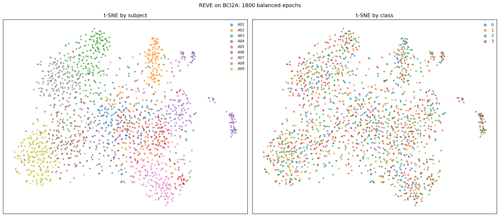
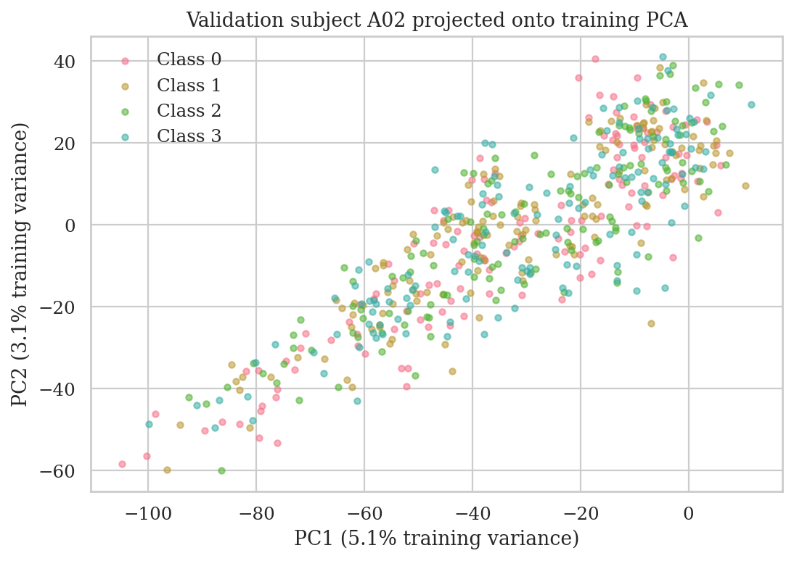
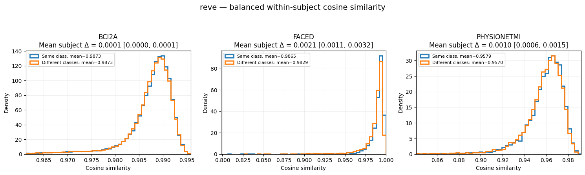
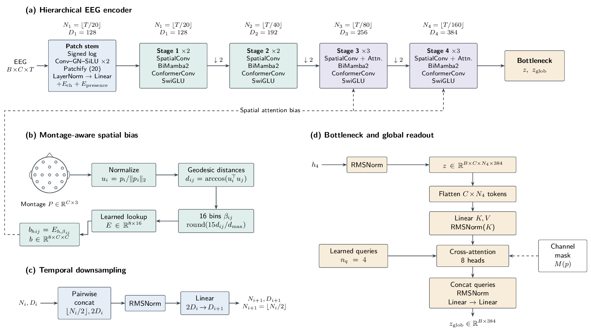
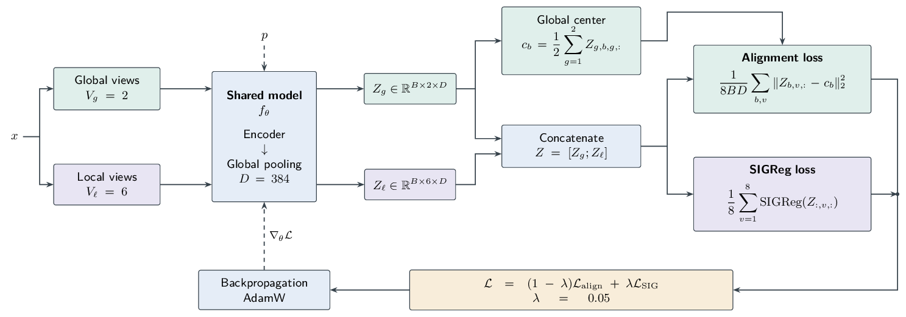

# EEG Foundation Models: Benchmark and Representation Analysis

How much task-relevant physiology do EEG foundation models preserve, and how well does it transfer across subjects? This internship project studies EEG as **multivariate time series**, comparing eight pretrained encoders with EEGNet and examining their latent representations. It also explores a hierarchical encoder trained with a joint-embedding objective.

**[Read the full report](report/report.pdf)** for protocols, complete results, references, and limitations ([LaTeX source](report/report.tex)). Data preparation spans 14 EEG corpora covering clinical abnormalities, seizures, sleep, motor imagery, emotion, and speech-related tasks. The reported model comparisons concern **BCI Competition IV-2a (BCI2A)**; REVE diagnostics additionally cover FACED and PhysioNet motor imagery. Processing coverage does not imply completed evaluations on every corpus.

## Repository

| Location | Contents |
| --- | --- |
| [`benchmark/`](benchmark/) | Downstream evaluation, SVM probing, t-SNE, cosine similarity, and PCA notebooks |
| [`benchmark/utils/configs/`](benchmark/utils/configs/) | Model checkpoints and downstream training settings |
| [`model/`](model/), [`configs/`](configs/), [`pretrain.py`](pretrain.py) | Proposed encoder and self-supervised training |
| [`benchmark/figures/`](benchmark/figures/), [`figures/`](figures/) | Analysis figures and architecture diagrams |
| [`report/`](report/) | Scientific report and bibliography |

## Running the benchmark

### 1. Prepare the environment and data

Install PyTorch for your hardware, JupyterLab, and the dependencies required by the selected official models, including their Mamba/CUDA requirements where applicable. The notebooks also use NumPy, pandas, Matplotlib, scikit-learn, PyYAML, einops, MNE, safetensors, Transformers, timm, and Braindecode. This repository does not currently provide a pinned environment.

Install the companion [`eeg_preprocessing` package](https://github.com/yrothlin-03/EEG_preprocessing_TELECOM_PARIS) and prepare the normalized LMDB datasets using its instructions. In **each notebook**, replace `LMDB_PATHS` with your local dataset paths. Review task metadata and split settings in [`benchmark/utils/downstream_data.yaml`](benchmark/utils/downstream_data.yaml).

### 2. Download the official models and checkpoints

Clone or download the official repositories into **`benchmark/models/`**, preserving these directory names:

| Models | Official repository | Local directory |
| --- | --- | --- |
| CBraMod | [wjq-learning/CBraMod](https://github.com/wjq-learning/CBraMod) | `benchmark/models/CBraMod/` |
| EEGMamba | [wjq-learning/EEGMamba](https://github.com/wjq-learning/EEGMamba) | `benchmark/models/EEGMamba/` |
| CSBrain | [yuchen2199/CSBrain](https://github.com/yuchen2199/CSBrain) | `benchmark/models/CSBrain/` |
| EEGPT | [BINE022/EEGPT](https://github.com/BINE022/EEGPT) | `benchmark/models/EEGPT/` |
| LaBraM | [935963004/LaBraM](https://github.com/935963004/LaBraM) | `benchmark/models/LaBraM/` |
| LUNA, LuMamba | [pulp-bio/BioFoundation](https://github.com/pulp-bio/BioFoundation) | `benchmark/models/BioFoundation/` |

For example, from the project root:

```bash
mkdir -p benchmark/models
git clone https://github.com/wjq-learning/CBraMod.git benchmark/models/CBraMod
```

Download compatible pretrained weights from the authors' releases, then update **`pretrained_weights` in `benchmark/utils/configs/<model>.yaml`**. Relative paths are resolved from `benchmark/`; absolute paths also work. For example, in `cbramod.yaml`:

```yaml
pretrained_weights: models/checkpoints/CBraMod/cbramod_checkpoint.pth
use_pretrained_weights: true
frozen: true
head: probe
channel_mode: mapped
```

**REVE is a special case:** the wrapper loads the complete [REVE-base model directory](https://huggingface.co/brain-bzh/reve-base), including configuration and modeling files, from `benchmark/models/checkpoints/reve-base/`. Point `reve.yaml` to its `model.safetensors`; downloading that file alone is insufficient. The wrapper also fetches the authors' electrode-position model on first use. See the [official REVE repository](https://github.com/brain-bzh/reve). EEGNet uses Braindecode and needs no pretrained weights. External repositories and checkpoints are not bundled here.

### 3. Run the notebooks

Launch Jupyter from **`benchmark/`**, which is required by several notebooks:

```bash
cd benchmark
jupyter lab
```

In [`benchmark.ipynb`](benchmark/benchmark.ipynb), edit the selection cell and run the cells in order:

```python
MODEL_NAMES = ["cbramod", "eegmamba", "eegnet"]
DATASET_NAMES = ["BCI2A"]
CHANNEL_MODES = ["mapped", "raw"]
```

The notebook trains the selected readout, selects the best validation checkpoint, and displays test metrics. Explicit `CHANNEL_MODES` override model defaults. `raw` means native channels from preprocessed data; `mapped` copies nearest source channels to a target montage, zero-filling unmatched locations.

For [`linear_probing.ipynb`](benchmark/linear_probing.ipynb), set `POOLING_MODES = ["avg_pooling"]` to reproduce the reported feature summary; the saved notebook currently selects `flatten`. The [t-SNE](benchmark/ablation_tsne.ipynb), [cosine](benchmark/ablation_cosine_sim.ipynb), and [PCA](benchmark/ab_pca_latent.ipynb) notebooks have their own model, dataset, and sampling settings. Keep subject splits and seeds fixed for controlled comparisons.

## Main observations

### Decoding and montage sensitivity

**BCI2A balanced accuracy (%)**, with a 25% chance reference:

| Model | Average pooling + linear SVM | Token-preserving head / EEGNet |
| --- | ---: | ---: |
| CBraMod | 30.08 | 36.69 |
| EEGMamba | 27.89 | 35.00 |
| CSBrain | 27.98 | 37.29 |
| LuMamba | 28.72 | 31.01 |
| LUNA | 28.61 | 34.78 |
| LaBraM | 27.72 | 42.60 |
| EEGPT | 26.80 | 53.47 |
| REVE | 33.31 | 65.21 |
| EEGNet, trained end to end | — | **76.77** |

The SVM uses **7 training / 2 test subjects**; the common head uses **7 training / 1 validation / 1 test subject**. These are single runs, not a matched readout ablation. Foundation backbones are frozen, while EEGPT and LaBraM additionally learn input adapters in the common-head protocol. `head: probe` preserves tokens and applies two affine projections without an intermediate activation: it is a **factorized linear readout**, whose parameter count varies by encoder.

Average-pooled features show weak cross-subject linear discrimination, but pooling may discard useful spatial and temporal contrasts. EEGNet, with approximately **3,000 parameters**, leads the reported comparable experiments; this does not establish superiority over fully fine-tuned foundation models or across all tasks.

The separate montage ablation gives:

| Model | Mapped | Raw |
| --- | ---: | ---: |
| CBraMod | 36.69 | **40.56** |
| EEGMamba | 35.00 | **40.00** |
| EEGNet | **75.30** | 63.91 |

Mapping has **model-dependent effects**, potentially involving channel duplication, omission, and changes in readout capacity ([mapping schematic](benchmark/figures/ablation_mapped_vs_raw/channelmapping.pdf)). The EEGNet mapped score comes from a separate run and is not averaged with the result above.

### What does the latent space show?

**t-SNE — subject structure is more apparent than task structure.** The same REVE embeddings are colored by subject and motor-imagery class. Subject-enriched neighborhoods coexist with broadly mixed task labels. This is consistent with pretraining retaining subject-specific cues, potentially including recurring physiological artifacts or acquisition effects, more visibly than task-related distinctions. It raises a concern about learning subject-dependent shortcuts instead of transferable task features. The projection cannot identify those cues as artifacts: genuine individual physiology can also produce subject structure.



**PCA — no clear class-characteristic directions emerge in the leading motor-imagery coordinates.** In the displayed validation subject, the four classes overlap and their average PCA colors are similar. This suggests that the dominant variation retained by the pretrained REVE encoder is not clearly organized around the motor-imagery classes. Together with weak pooled-SVM results across the eight encoders, it questions how readily pretraining exposes transferable task-specific directions. The PCA itself does not establish this for every model or exclude class information in other directions: its first two components explain only about 8.2% of training variance.

The projection is fitted on training subjects only. Across folds, ten components explain 21.20% of training variance and capture 14.08% of held-out energy relative to the training mean. The lower held-out capture is compatible with subject-dependent structure, but also with PCA being optimized for training variance.



The [class-average colors](benchmark/figures/ablation_pca/mean_pca_rgb.png) and [epoch-level signal view](benchmark/figures/ablation_pca/pca_by_window.png) provide complementary inspections, without identifying physiological mechanisms or labeling artifacts.

**Cosine similarity — distributions concentrate near 1, with little angular class contrast.** Same-class and different-class pairs have high similarities (displayed means approximately 0.957–0.987) and largely overlapping distributions. The concentration near 1 indicates that the pooled vectors point in very similar directions, regardless of class. Because features are not centered, a dominant shared mean component can produce this effect; averaging tokens can further suppress differences. It does **not** mean that all embeddings are identical or that the representation has collapsed. Small residual directions may still carry information. The plots also zoom into different horizontal ranges, so their apparent widths and density peaks are not directly comparable across datasets.



Together, these diagnostics motivate physiological validation and controls for subject identity, pooling, and latent dimensionality. They concern **REVE**, and should not be generalized to every model. Decoding scores and geometric metrics alone cannot establish what physiological information a representation uses.

## Proposed architecture and training

The proposed encoder combines channel-wise patch tokenization, hierarchical spatial mixing, and bidirectional Mamba2 temporal processing. Electrode geometry informs spatial attention; a learned-query readout produces a global embedding while retaining token-level outputs.



Training aligns global and local views of the same EEG window, with **LeJEPA's non-contrastive joint-embedding objective** and SIGReg regularization to oppose collapse. The proposed objective does not reconstruct waveforms. Its usefulness depends on augmentations that vary nuisance components while preserving task-relevant physiology; latent alignment alone does not guarantee artifact invariance.



**This training could not be brought to convergence within the internship timeline.** No downstream results validate the proposed architecture. It remains a research direction for controlled comparisons of reconstruction, latent alignment, and hybrid objectives, with interpretable and reproducible cross-subject transfer as the target.
